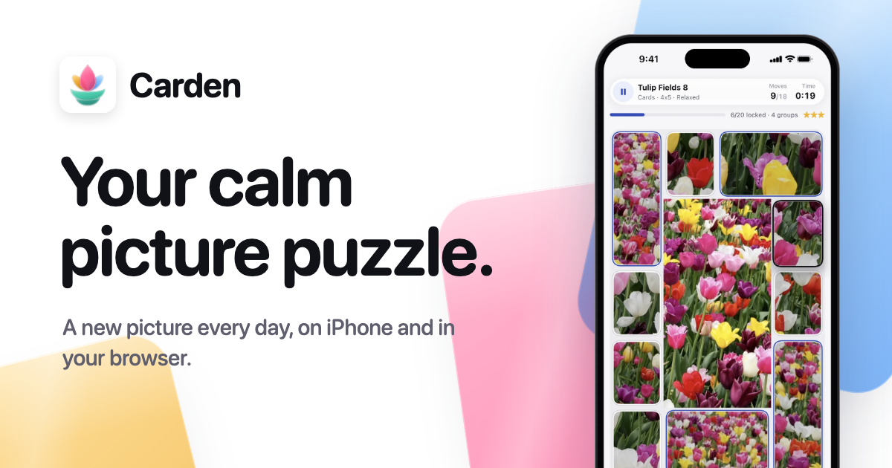

# Carden website

The homepage of [Carden](https://www.carden.page), the calm picture puzzle: swap cards until the
picture is whole. A single page, prerendered to static HTML.



## Stack

- [TanStack Start](https://tanstack.com/start) 1.169 with React 19, prerendered at build time
- [Tailwind CSS](https://tailwindcss.com) 4
- [shadcn/ui](https://ui.shadcn.com) (the `base-nova` style on Base UI): Button, Card, Badge, Tabs, Toggle Group,
  Accordion, Sheet, Dropdown Menu, Separator
- Light and dark themes (follows the device, with a Light / Dark / Auto switch that is remembered)

## Run it

```sh
pnpm install
pnpm dev        # http://localhost:3000
pnpm build      # static site in dist/client (index.html and assets)
pnpm lint && pnpm typecheck
```

`dist/client` can be served by any static host.

## Deploy

The site lives on Appwrite Sites as `carden-website` in the Carden project (`appwrite.config.json`), at
https://www.carden.page (carden.page redirects there; the game is at https://play.carden.page). With the [Appwrite CLI](https://appwrite.io/docs/tooling/command-line/installation)
signed in to an account that can reach the project:

```sh
scripts/deploy.sh   # builds with VITE_SITE_URL set, uploads dist/client, waits until it is live
```

## Settings

Set at build time (for example `VITE_SITE_URL=https://example.com pnpm build`):

| Variable | Purpose |
| --- | --- |
| `VITE_SITE_URL` | The site's public address, `https://www.carden.page` when unset. Share previews (Open Graph, X) need an absolute image address, and the page gets a canonical link. |
| `VITE_APP_STORE_LIVE` | `true` once Carden is on the App Store: the beta link becomes Apple's official "Download on the App Store" badge, the footer adds Apple's trademark line, and Safari on iPhone shows the Smart App Banner. Leave it off until then: Apple's badge may only point to an app that can be downloaded. |

Links (the web game, the TestFlight beta, the App Store page, privacy policy, terms, support email) live in
`src/config.ts`.

## Design

The site follows the app and its App Store screenshots:

- **Colour.** White canvas and neutral greys; one accent, cobalt `#2F4FBF` (`#7C9AFF` / `#4065DD` in dark).
  The colour comes from the pictures and from large panes of coloured glass in the lotus colours of the
  app icon (pink, gold, blue, teal). On white the panes multiply, so overlaps mix like stained glass; in dark
  they turn into deep jewel tones. Tokens and the `.glass-pane` style are in `src/styles.css`.
- **Rhythm.** Section bands alternate white and dim one by one (by position, in `styles.css`), and the
  panes run across the bands: sections do not clip their panes, the page does. Each boundary has one
  pane crossing it, on alternating sides; next to text it stays in the side margin (anchored to the
  content edge, `calc(50% - 556px - <width>)`), and only behind phones and boards does a pane reach
  into a column. A dim band is the white ground seen through a filter sheet laid over the panes, so a
  pane changes tint exactly where it crosses into it (layers: panes, the band's sheet, content).
- **Write `backdrop-filter` without the `-webkit-` copy.** The build adds the prefix; writing both
  made it keep only the prefixed one, which Chrome ignores.
- **Contrast.** Every line of text keeps 4.5:1 against what is really behind it, panes included (3:1
  for large headlines), in both themes, on phones and desktops. Check after moving a pane.
- **Type.** Headlines in SF Pro Rounded (`ui-rounded`, so Safari on Apple devices shows it), body text in the
  system face. No web fonts: the page loads nothing from other hosts.
- **Pictures.** Real screens from the game, framed like the store screenshots, and real pack covers, all
  served from this site.

## Images

Every app screen on the page is one of the App Store captures (the Carden repo's
`integration_test/store_screenshots_test.dart`), in both themes: the light run's capture shows on the light
site and the dark run's capture of the same scene on the dark site (`ThemedImage`, `<name>.webp` and
`<name>-dark.webp`). `scripts/prepare-assets.py` frames them and writes `public/screens`, `public/boards`,
`public/cards` and `public/covers` (it needs the Carden app repo next to this one, and its Python
environment):

```sh
../card-jigsaw-world/.venv/bin/python scripts/prepare-assets.py              # both themes and the covers
../card-jigsaw-world/.venv/bin/python scripts/prepare-assets.py --no-covers  # screens only
```

The logo section uses the app icon's own drawing (`tools/brand/icon-glass.js` in the Carden repo):
`scripts/export-lotus.mjs` renders every iOS look, the tints and the five glass pieces into `public/brand`,
and writes the pieces' outlines, anchors and handles to `src/components/site/lotus-geometry.ts`:

```sh
node scripts/export-lotus.mjs
```

The playable boards (Painting and the giant board) are `src/components/site/puzzle-toy.tsx`, the streak
card is `streak.tsx` (its gifts follow the app's `Economy.dailyRewards`), and the photo picker and widgets
are drawn in HTML. Their pictures are catalogue pictures in `public/pictures`, fetched by
`prepare-assets.py`; the widgets and boards use only public-domain or CC0 pictures.

**Picture credits.** Many pack covers are CC BY or CC BY-SA, so the page credits every catalogue picture
it shows (footer, Picture credits). `prepare-assets.py` writes the list
(`src/components/site/picture-credits.json`) from the catalogue's author and licence fields; run it again
whenever a picture on the page changes.

The step boards in "Two taps make a move" (`src/components/site/mini-board.tsx`, `.mb-*` in `src/styles.css`)
are drawn in CSS the way the game draws its board, from a pack cover.

The share thumbnail `public/og.png` (1200 x 630) is rendered from `scripts/og/og.html`, and the tab icon
(`public/favicon.svg` from `export-lotus.mjs`: the flower alone, light and dark glass) to a PNG copy:

```sh
scripts/render-og.sh
scripts/render-favicon.sh
```

The code is yours to read and learn from; the Carden name, icon, screenshots and pictures are not licensed
for reuse.

## Copy

Calm, warm and precise, like the game: buttons start with a verb, no exclamation marks, no emoji, and every
claim is true in the game today. Before changing a fact (prices, levels, what is free), check it in the app.

## Agent skills

`.agents/skills/shadcn` is the official shadcn/ui skill (`npx skills add shadcn-ui/ui@shadcn`) and
`.agents/skills/frontend-design` Anthropic's frontend design skill (`npx skills add anthropics/skills@frontend-design`),
both linked for Claude Code in `.claude/skills`.
